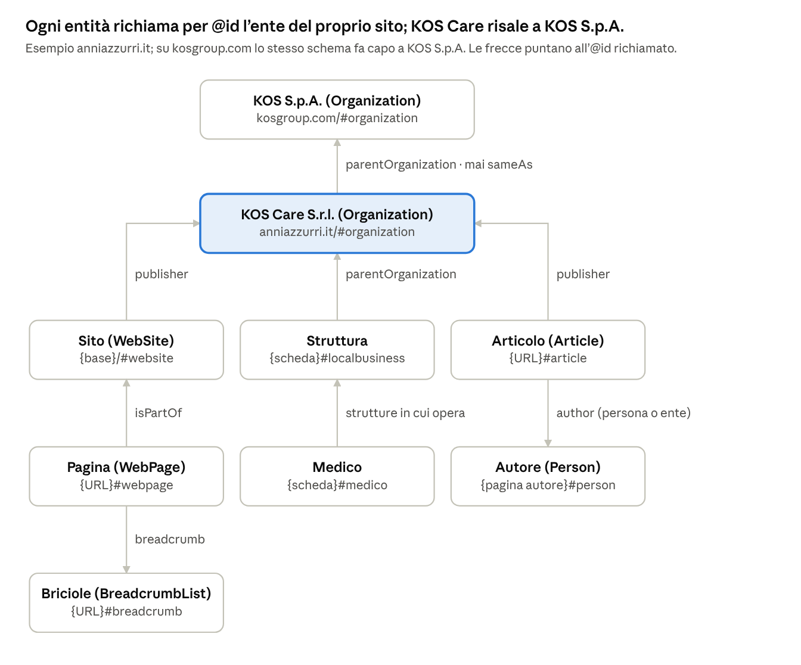

# Convenzione degli identificativi del dato strutturato

Danilo Bernabeo · 29 ottobre 2026 (copia della scheda condivisa «Convenzione degli identificativi del dato strutturato»)

Ogni entità descritta nel dato strutturato di kosgroup.com e anniazzurri.it ha un identificativo (`@id`) formato dall'URL canonico della pagina che la descrive più un frammento fisso per tipo di entità. La convenzione vale per entrambi i siti ed è già applicata su anniazzurri.it dal 20 ottobre 2026.

## Regole

Un'entità ha un solo `@id`, e tutte le pagine che la citano usano quello invece di descriverla di nuovo.

- **Forma**: URL canonico della pagina che descrive l'entità + frammento fisso del tipo (`#organization`, `#localbusiness`...).
- **Generato dal codice**, mai scritto a mano nei contenuti o nei chunk: una sola funzione per sito costruisce tutti gli identificativi.
- **Basato sugli indirizzi del sito**, non sui codici di Yext o RetailTune: resta lo stesso quando cambia la piattaforma dei dati anagrafici.
- **Un solo `@graph` JSON-LD per pagina**, emesso lato server, così i crawler che non eseguono JavaScript lo leggono intero.

## Forma canonica dei domini

Gli identificativi usano sempre la forma del dominio verso cui puntano canonical, sitemap e redirect, verificata il 15 ottobre 2026.

| Sito | Base | Regola |
| --- | --- | --- |
| anniazzurri.it | `https://anniazzurri.it` | senza www; slash finale solo sulla home |
| kosgroup.com | `https://kosgroup.com` | senza www; pagine sotto `/it` (italiano) e `/en` (inglese); l'ente resta alla radice |

## Identificativi

| Entità | Tipo schema.org | `@id` | Esempio |
| --- | --- | --- | --- |
| Ente anniazzurri.it (KOS Care S.r.l.) | `Organization` | `{base}/#organization` | `https://anniazzurri.it/#organization` |
| Ente kosgroup.com (KOS S.p.A.) | `Organization` | `{base}/#organization` | `https://kosgroup.com/#organization` |
| Sito | `WebSite` | `{base}/#website` | `https://anniazzurri.it/#website` |
| Pagina | `WebPage` e sottotipi | `{URL}#webpage` | `https://anniazzurri.it/rsa-in-lombardia#webpage` |
| Briciole | `BreadcrumbList` | `{URL}#breadcrumb` | `https://anniazzurri.it/residenza-anni-azzurri-vico-mercati#breadcrumb` |
| Struttura o residenza | `LocalBusiness` e sottotipi | `{URL scheda}#localbusiness` | `https://anniazzurri.it/residenza-anni-azzurri-navigli#localbusiness` |
| Medico | `IndividualPhysician` | `{URL scheda}#medico` | `https://kosgroup.com/it/chi-siamo/qualita-delle-cure/medici/nome-cognome#medico` |
| Altro professionista sanitario | `Person` | `{URL scheda}#person` | `https://kosgroup.com/it/chi-siamo/qualita-delle-cure/medici/nome-cognome#person` |
| Articolo | `Article` | `{URL}#article` | `https://anniazzurri.it/come-vivono-gli-anziani-in-rsa#article` |
| Autore | `Person` | `{URL pagina autore}#person` | `https://anniazzurri.it/autori/nome-cognome#person` |
| Servizio | `Service` | `{URL}#service` | `https://anniazzurri.it/sportello-sociale-orientamento-per-assistenza-anziani#service` |
| Patologia | `MedicalCondition` | `{URL}#condition` | pagina della patologia su kosgroup.com + #condition |
| Dispositivo o tecnologia | `MedicalDevice` | `{URL}#device` | pagina della tecnologia su kosgroup.com + #device |

Le strutture usano `#localbusiness`, come indicato nelle slide 29-30 dell'audit Anni Azzurri. Il nodo struttura si emette solo se la pagina ha l'indirizzo. Tipi (deciso il 29 ottobre 2026):

- **Residenze**: `["MedicalBusiness", "MedicalOrganization"]` con `medicalSpecialty` `Geriatric`. Schema.org non ha un tipo per le case di riposo (`NursingHome` non esiste, verificato su schema.org 30.1): `MedicalBusiness` è un sottotipo di `LocalBusiness`, come chiede l'audit Anni Azzurri (slide 30) e come richiede Google (il sottotipo più specifico), mentre `MedicalOrganization` porta la specialità. Il tipo dipende dall'autorizzazione della struttura, non dall'accreditamento: tutte le residenze Anni Azzurri sono autorizzate come unità socio-sanitarie (RSA, Casa Residenza Anziani, Residenza Protetta), come risulta dalle carte dei servizi; `LocalBusiness` resta solo per le unità socio-assistenziali pure (alloggi protetti, casa di riposo).
- **Cliniche, centri e ambulatori**: il sottotipo sanitario più specifico (`MedicalClinic`, `Hospital`...); un tipo che non è un'attività locale (es. `DiagnosticLab`) si affianca a `MedicalBusiness`.
- **Servizi senza sede propria** (RSA Aperta, assistenza domiciliare): `Service` con `provider` verso il `#localbusiness` della struttura che li eroga.
- **Medici**: `IndividualPhysician` (sottotipo di `Physician`, il tipo dell'esempio dell'audit KosGroup, slide 27) con `practicesAt` verso il `#localbusiness` della struttura; gli altri professionisti sanitari `Person` con `jobTitle`.

## Relazioni



Ogni freccia è un richiamo per `@id`: l'entità richiamata è descritta una sola volta e le altre pagine la citano senza ripeterla. Tra KOS Care e KOS S.p.A. il legame è solo `parentOrganization`, mai `sameAs`, perché sono soggetti giuridici diversi.

## Pagine in più lingue (kosgroup.com)

Un'entità è una sola in tutte le lingue: il suo `@id` si ancora sempre alla pagina italiana (`/it/...`), e la pagina inglese equivalente richiama lo stesso `@id`. La lingua è una proprietà della pagina (`inLanguage`), non dell'entità.

## Esempio in produzione

Il `@graph` di [Residenza Anni Azzurri Vico Mercati](https://anniazzurri.it/residenza-anni-azzurri-vico-mercati), validato con validator.schema.org (0 errori) e Rich Results Test (Breadcrumb e Organization validi). Le briciole corrispondono a quelle visibili e all'esempio della slide 35 dell'audit.

```json
{
  "@context": "https://schema.org",
  "@graph": [
    {
      "@type": "WebPage",
      "@id": "https://anniazzurri.it/residenza-anni-azzurri-vico-mercati#webpage",
      "url": "https://anniazzurri.it/residenza-anni-azzurri-vico-mercati",
      "isPartOf": { "@id": "https://anniazzurri.it/#website" },
      "breadcrumb": { "@id": "https://anniazzurri.it/residenza-anni-azzurri-vico-mercati#breadcrumb" }
    },
    {
      "@type": "BreadcrumbList",
      "@id": "https://anniazzurri.it/residenza-anni-azzurri-vico-mercati#breadcrumb",
      "itemListElement": [
        { "@type": "ListItem", "position": 1, "name": "Anni Azzurri", "item": "https://anniazzurri.it/" },
        { "@type": "ListItem", "position": 2, "name": "Le RSA in Lombardia", "item": "https://anniazzurri.it/rsa-in-lombardia" },
        { "@type": "ListItem", "position": 3, "name": "RSA in provincia di Monza e Brianza", "item": "https://anniazzurri.it/rsa-in-provincia-di-monza-e-brianza" },
        { "@type": "ListItem", "position": 4, "name": "Residenza Anni Azzurri Vico Mercati", "item": "https://anniazzurri.it/residenza-anni-azzurri-vico-mercati" }
      ]
    },
    {
      "@type": "WebSite",
      "@id": "https://anniazzurri.it/#website",
      "publisher": { "@id": "https://anniazzurri.it/#organization" }
    },
    {
      "@type": "Organization",
      "@id": "https://anniazzurri.it/#organization",
      "name": "Anni Azzurri",
      "legalName": "KOS Care S.r.l.",
      "vatID": "IT01148190547",
      "parentOrganization": {
        "@id": "https://kosgroup.com/#organization",
        "@type": "Organization",
        "legalName": "KOS S.p.A.",
        "vatID": "IT10674520159"
      }
    }
  ]
}
```

Nell'esempio alcune proprietà (descrizione, logo, indirizzo, social) sono omesse per brevità.
